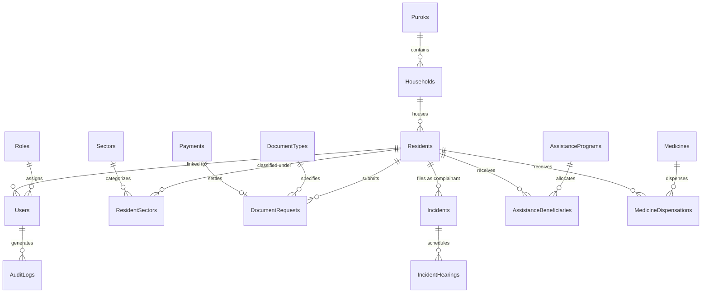

# FATHER SATURNINO URIOS UNIVERSITY
### College of Information Technology
### Butuan City

<br>

# BIMS: BARANGAY INFORMATION MANAGEMENT SYSTEM WITH PAPERLESS QR VERIFICATION, ANTI-DUPLICATE AYUDA TRACKING, AND INTEGRATED REST APIS

<br>

**A Final Project Documentation**  
Presented to the Faculty of the College of Information Technology  
Father Saturnino Urios University  

<br>

**In Partial Fulfillment of the Requirements in**  
**SIA 2: Systems Integration and Architecture 2**

<br>

**Submitted by:**  
**Group [YOUR GROUP NAME]**  
[Member 1 Name]  
[Member 2 Name]  
[Member 3 Name]  
[Member 4 Name]  
[Member 5 Name]  

<br>

**Submitted to:**  
**John Michael Tripoli**  

**October 2026**

---

## Abstract

Record-keeping and public service delivery in most Philippine barangays are still handled manually using paper logbooks and pre-printed forms. This setup causes long queues at the barangay hall, makes physical records vulnerable to loss or damage, allows fake clearances to circulate undetected, and makes it possible for individuals to claim financial or calamity assistance multiple times. This project developed the Barangay Information Management System (BIMS), a web-based e-governance platform that digitizes community records, enforces strict integrity rules, and integrates with external systems. 

BIMS is composed of four integrated components: a responsive web application built with Django and modern frontend templates, a 3NF-normalized relational database modeling 22 core entities, an automated tamper-proof QR code verification engine, and a stateless RESTful API (`/api/v1/`) for third-party lookups and municipal reporting. The system manages resident demographic census profiling, household hierarchies, Katarungang Pambarangay mediation hearings, health center consultations, and medicine dispensary inventory. It enforces an anti-duplicate assistance constraint (`UNIQUE(ProgramID, ResidentID)`) so that no resident can claim aid more than once within the same relief program. 

User accounts are safeguarded by PBKDF2 password hashing, role-based access control (Admin, Staff, and Citizen), and comprehensive audit trail logging in compliance with the Data Privacy Act of 2012 (Republic Act No. 10173). The finished system passed 15 automated backend and API tests with a 100% pass rate. The results demonstrate that BIMS makes certificate issuance significantly faster, eliminates double claiming, and allows instant verification of official documents by employers, banks, and public agencies.

**Keywords:** barangay governance, systems integration, REST API, Django, QR code verification, anti-duplicate ayuda, role-based access control, RA 10173

---

## Table of Contents

* [Abstract](#abstract)
* [Table of Contents](#table-of-contents)
* [1. Introduction](#1-introduction)
  * [1.1 Background of the Study](#11-background-of-the-study)
  * [1.2 Statement of the Problem](#12-statement-of-the-problem)
  * [1.3 Objectives of the Study](#13-objectives-of-the-study)
  * [1.4 Scope and Limitations](#14-scope-and-limitations)
  * [1.5 Significance of the Study](#15-significance-of-the-study)
* [2. System Overview](#2-system-overview)
  * [2.1 System Description](#21-system-description)
  * [2.2 Main Features](#22-main-features)
  * [2.3 Users and Roles](#23-users-and-roles)
  * [2.4 Tools and Technologies](#24-tools-and-technologies)
* [3. System Architecture and Integration](#3-system-architecture-and-integration)
  * [3.1 System Architecture](#31-system-architecture)
  * [3.2 Backend Request Flow](#32-backend-request-flow)
  * [3.3 Integration Points](#33-integration-points)
  * [3.4 Data Flow](#34-data-flow)
  * [3.5 Live Verification and Notifications](#35-live-verification-and-notifications)
* [4. Database Design](#4-database-design)
  * [4.1 Entity-Relationship Diagram](#41-entity-relationship-diagram)
  * [4.2 Normalization](#42-normalization)
  * [4.3 Data Dictionary](#43-data-dictionary)
* [5. API Documentation](#5-api-documentation)
  * [5.1 Overview](#51-overview)
  * [5.2 Status Codes and Error Format](#52-status-codes-and-error-format)
  * [5.3 Sample Requests and Responses](#53-sample-requests-and-responses)
* [6. Security Measures](#6-security-measures)
  * [6.1 Authentication](#61-authentication)
  * [6.2 Password Security](#62-password-security)
  * [6.3 Role-Based Access Control](#63-role-based-access-control)
  * [6.4 Protection Against Attacks](#64-protection-against-attacks)
  * [6.5 Citizen Data Privacy (RA 10173)](#65-citizen-data-privacy-ra-10173)
  * [6.6 Data Integrity](#66-data-integrity)
* [7. User Interface and User Manual](#7-user-interface-and-user-manual)
  * [7.1 Signing In](#71-signing-in)
  * [7.2 Administrator Tasks](#72-administrator-tasks)
  * [7.3 Staff Tasks](#73-staff-tasks)
  * [7.4 Citizen Tasks](#74-citizen-tasks)
* [8. Testing](#8-testing)
  * [8.1 Testing Approach](#81-testing-approach)
  * [8.2 Test Results](#82-test-results)
  * [8.3 Test Cases](#83-test-cases)
  * [8.4 Defects Found and Fixed](#84-defects-found-and-fixed)
* [9. Deployment and Installation Guide](#9-deployment-and-installation-guide)
  * [9.1 Requirements](#91-requirements)
  * [9.2 Local Installation](#92-local-installation)
  * [9.3 Running the Tests](#93-running-the-tests)
  * [9.4 Production Deployment](#94-production-deployment)
* [10. Team Roles and Contributions](#10-team-roles-and-contributions)
* [11. Conclusion and Recommendations](#11-conclusion-and-recommendations)
  * [11.1 Conclusion](#111-conclusion)
  * [11.2 Recommendations](#112-recommendations)
* [References](#references)
* [Appendices](#appendices)
  * [Appendix A. Project Folder Structure](#appendix-a-project-folder-structure)
  * [Appendix B. Barangay Business Rules](#appendix-b-barangay-business-rules)
  * [Appendix C. Main Configuration Settings](#appendix-c-main-configuration-settings)
  * [Appendix D. Glossary](#appendix-d-glossary)

---

## 1. Introduction

### 1.1 Background of the Study
The barangay is the primary frontline unit of local governance in the Philippines. It handles citizen records, issues community clearances and indigency certificates, conducts amicable mediation under the Katarungang Pambarangay system, and manages the distribution of financial aid and calamity relief. 

In everyday practice, most barangay halls still rely on handwritten logbooks and printed certificates. Searching for a resident's historical record can take significant time, and paper files deteriorate or get misplaced easily. In addition, printed documents lack digital verification mechanisms, allowing forged barangay clearances to pass undetected by employers and banks. 

During calamity and relief operations, distributing aid without real-time database tracking often leads to duplicate claiming, where the same person claims assistance multiple times across different distribution tables. BIMS was developed to solve these fundamental challenges through an integrated web application, anti-tamper QR code verification, and open REST APIs.

### 1.2 Statement of the Problem
This project addresses the following problems:
1. **Slow Manual Processing:** Issuing clearances and locating records using physical logbooks requires citizens to wait in long lines.
2. **Document Forgery:** Paper clearances and permits lack verifiable cryptographic proofs, allowing counterfeit documents to circulate.
3. **Double Claiming Aid (Ayuda Fraud):** Relief goods and cash assistance are vulnerable to duplicate claiming without centralized transactional constraints.
4. **Lack of System Interoperability:** External agencies (e.g., city government, employers, banks) have no programmatic way to verify citizen status or clearance authenticity.

### 1.3 Objectives of the Study
**General objective:** To develop a secure, integrated Barangay Information Management System that provides paperless document requests, tamper-proof QR verification, anti-duplicate aid distribution, and standardized REST API endpoints.

**Specific objectives:** The project specifically aims to:
1. provide an online citizen intake portal with administrative review and temporary password generation;
2. generate printable barangay clearances embedded with unique QR code hashes for instant public verification;
3. enforce a database constraint preventing duplicate beneficiary aid claims within the same program;
4. expose live REST API endpoints (`/api/v1/`) for health checks, verification, demographic metrics, and resident lookups;
5. enforce Role-Based Access Control (Admin, Staff, and Citizen) with audit trail logging under RA 10173; and
6. deliver an interactive demographic analytics dashboard using Chart.js.

### 1.4 Scope and Limitations
The system covers three types of users: Administrators, Staff, and Citizens. It includes resident census profiling, bulk CSV ingestion, document processing, blotter mediation scheduling, pharmacy inventory, and REST APIs.

The system has the following limitations:
* Scanning a QR code requires an active internet connection to query the verification server.
* The system does not currently process online credit card/GCash payments directly; fees are logged via Official Receipt numbers encoded by the Barangay Treasurer.
* SMS notifications require an external SMS gateway integration (e.g., Semaphore or Twilio) for live cellular alerts.

### 1.5 Significance of the Study
* **Barangay Officials & Staff:** Save hours of manual paperwork, prevent duplicate aid distributions, and maintain an organized census.
* **Citizens:** Can apply for clearances online, track their application status, and avoid waiting in long lines at the barangay hall.
* **Third Parties (Employers, Banks, Embassies):** Can scan the QR code on any certificate to instantly confirm whether it was authentically issued by the barangay.
* **Researchers and Developers:** Serves as a reference implementation of a 3NF-normalized, secure Django web architecture with integrated REST APIs.

---

## 2. System Overview

### 2.1 System Description
BIMS is a web application that runs in any modern browser. Users sign in with their assigned username and password, and each user only accesses the features and records permitted by their role. Administrators configure barangay officials and settings, review audit logs, and approve citizen registrations. Staff encode walk-in residents, process clearance requests, issue official receipts, schedule blotter hearings, and disburse relief aid. Citizens submit document requests and track their status online.

When a citizen applies for a clearance, the request enters a `Pending` state. Staff review the request, verify payment details, and approve it. Upon approval, the system generates a unique cryptographic hash and embeds a QR code onto the official certificate. When anyone scans this QR code using a smartphone, the system displays the live verification badge with the recipient's details, date of issuance, and official receipt number.

### 2.2 Main Features

**Table 1. Main features of BIMS**
| Feature | Description |
| :--- | :--- |
| **Online Citizen Intake** | Citizens register online and track status via a tracking number (`REG-YYYYMM-XXXXXX`). |
| **Paperless QR Verification** | Clearances embed a unique QR code hash (`BIMS-YYYYMM-...`) validated at `/verify/<hash>/`. |
| **Anti-Duplicate Ayuda Tracking** | Enforces `UNIQUE(ProgramID, ResidentID)` to prevent multiple aid claims in the same program. |
| **Katarungang Pambarangay** | Records confidential blotter complaints and schedules 1st, 2nd, and 3rd summons hearings. |
| **Clinic & Pharmacy Dispensary** | Logs patient consultations and automatically deducts stock upon medicine dispensation. |
| **Bulk Census CSV Ingestion** | Ingests hundreds of resident profiles at once from standardized CSV survey files. |
| **Dynamic Barangay Profile** | Admin can update officials, seals, and hall contact details without editing code. |
| **REST API Layer (`/api/v1/`)** | Exposes live JSON endpoints for external verifiers, city portals, and Postman testing. |

### 2.3 Users and Roles

**Table 2. User roles and their permissions**
| Role | Can do | Cannot do |
| :--- | :--- | :--- |
| **Administrator** | Manage user accounts; configure barangay profile & signatories; view audit logs; approve citizen registrations; view demographic analytics. | Cannot delete records with active transaction histories. |
| **Staff** | Register walk-in residents; process clearance applications; issue receipts; schedule blotter hearings; disburse aid and medicines. | Cannot modify system-wide settings, user roles, or view audit logs. |
| **Citizen (People)** | Register online; view own profile; submit clearance requests; check application status; view barangay bulletins. | Cannot access administrative dashboards or view other citizens' records. |

### 2.4 Tools and Technologies

**Table 3. Tools and technologies used**
| Layer | Technology | Purpose |
| :--- | :--- | :--- |
| **Frontend** | HTML5, Vanilla CSS, Tailwind, Lucide Icons, Chart.js | Responsive user interface, visual analytics, and icons |
| **Backend** | Python 3.12, Django 6.1 | Web framework, business logic, ORM, and template rendering |
| **API Layer** | Django Views (`JsonResponse`), RESTful design | Stateless JSON API endpoints under `/api/v1/` |
| **Database** | SQLite 3 (3NF normalized) | Relational database storage |
| **QR Code Engine** | Python `qrcode`, Pillow (PIL) | Cryptographic QR image generation |
| **Testing** | Django Test Runner, `unittest` | Automated unit testing and integration verification |

---

## 3. System Architecture and Integration

### 3.1 System Architecture
BIMS implements a client-server architecture combining Django's Model-View-Template (MVT) pattern with a decoupled REST API service layer.

```
+-----------------------------------------------------------------------------------+
|                                 CLIENT LAYER                                      |
|  [Citizen Browser]        [Admin/Staff Portal]         [External Client / Postman]|
+---------+--------------------------+-------------------------------+--------------+
          | HTTPS                    | HTTPS                         | HTTPS (JSON)
          v                          v                               v
+-----------------------------------------------------------------------------------+
|                        APPLICATION SERVER LAYER (Django 6)                        |
|                                                                                   |
|  +---------------------------+  +----------------------------------------------+  |
|  |     Security Middleware   |  |            Routing Engine (urls.py)          |  |
|  |  (CSRF, Session, RBAC)    |  |     /dashboard/   /documents/   /api/v1/     |  |
|  +-------------+-------------+  +----------------------+-----------------------+  |
|                |                                       |                          |
|                v                                       v                          |
|  +---------------------------+  +----------------------------------------------+  |
|  |    Standard Views Layer   |  |          REST API Layer (api_views.py)       |  |
|  |  - residents_list         |  |  - api_health          - api_residents_search|  |
|  |  - document_process       |  |  - api_document_verify - api_doc_request_sub |  |
|  |  - assistance_programs    |  |  - api_statistics_sum - api_document_types  |  |
|  +-------------+-------------+  +----------------------+-----------------------+  |
|                |                                       |                          |
|                +-------------------+-------------------+                          |
|                                    |                                              |
|                                    v                                              |
|  +-----------------------------------------------------------------------------+  |
|  |                     Django ORM & Business Logic Layer                       |  |
|  |   Resident | Household | DocumentRequest | Payment | AssistanceBeneficiary      |  |
|  +---------------------------------+-------------------------------------------+  |
+------------------------------------|----------------------------------------------+
                                     | SQL Queries
                                     v
+-----------------------------------------------------------------------------------+
|                               DATABASE STORAGE LAYER                              |
|                    SQLite Relational Database Engine (3NF Normalized)             |
|   [22 Tables: Residents, Households, Payments, AuditLogs, BarangaySettings, etc.] |
+-----------------------------------------------------------------------------------+
```
*Figure 1. System architecture of BIMS*

### 3.2 Backend Request Flow
Inside the backend, every incoming HTTP request passes through a defined sequence of layers:

```
[HTTP Request] 
      │
      ▼
[urls.py] ─── Routing & Endpoint Matching
      │
      ▼
[@login_required / @role_required] ─── Authentication & RBAC Check
      │
      ▼
[views.py / api_views.py] ─── Business Logic & Input Validation
      │
      ▼
[models.py (ORM)] ─── Data Constraints & SQL Abstraction
      │
      ▼
[SQLite Database Engine] ─── ACID-Compliant Transaction Storage
```
*Figure 2. Layers of a request inside the backend*

### 3.3 Integration Points

**Table 4. Integration points of the system**
| Integration | Method | Data Exchanged |
| :--- | :--- | :--- |
| **Web Browser and Application** | HTTP/HTTPS requests with session cookies | HTML views, form submissions, and Chart.js datasets |
| **External Verifier and API** | `GET /api/v1/verify/<qr_hash>/` | Cryptographic hash in, verification JSON payload out |
| **City Dashboard and API** | `GET /api/v1/statistics/summary/` | Aggregate demographics, voter ratios, and revenue totals |
| **Client Search and API** | `GET /api/v1/residents/search/?q=` | Query string in, filtered resident records in JSON out |
| **External App and Intake** | `POST /api/v1/documents/request/` | JSON request payload in, clearance ID and QR hash out |

### 3.4 Data Flow
Figure 3 shows the Context Diagram (DFD Level 0) of BIMS.

```
                  +--------------------------------+
                  |            Citizen             |
                  +---------------+----------------+
                                  |
            Registration /        |   Approved Clearance /
            Clearance Request     |   Verification Status
                                  v
                       +-----------------------+
                       |           0           |
                       |         BIMS          |
                       |      Web System       |
                       +-----------+-----------+
                                   ^
            Official Profile /     |   Demographic Reports /
            Blotter Hearing /      |   Revenue & Audit Logs
            Aid Disbursement       |
                                   |
                  +----------------+---------------+
                  |        Barangay Staff          |
                  +--------------------------------+
```
*Figure 3. Context diagram (DFD Level 0) of BIMS*

Figure 4 illustrates the detailed data flow for processing and verifying a document clearance.

```
[Citizen] ──(1) Submit Request──> [BIMS Server] ──(2) Save Pending Request──> [(Database)]
                                        │
[Staff] ────(3) Process Request ────────┘
            (Encode OR# and Fee)
                    │
            (4) Generate QR Hash (BIMS-YYYYMM-...)
            (5) Mark Status: Approved
            (6) Save Payment Record ──────────────────────────────────────────> [(Database)]
                    │
            (7) Render Certificate with QR Code
                    │
                    v
[Verifier / Employer] ──(8) Scan QR Code ──> [GET /verify/<hash>/] 
                                                    │
                                             (9) Query Database ──────────────> [(Database)]
                                                    │
                            <──(10) Return Authentic Seal & Status ───────────┘
```
*Figure 4. Data flow of document clearance issuance and verification*

### 3.5 Live Verification and Notifications
When a printed certificate is presented to an employer or bank, scanning the QR code directs the browser to `/verify/<qr_hash>/`. The system performs a live query against `DocumentRequests`, verifying the certificate's status, recipient name, date of issuance, and official receipt number without exposing any personal passwords or administrative backend portals.

---

## 4. Database Design

### 4.1 Entity-Relationship Diagram
Figure 5 illustrates the relational database design connecting the main tables.


*Figure 5. Entity-relationship diagram of the main tables*

### 4.2 Normalization
The database is strictly normalized to the **Third Normal Form (3NF)**:
1. **1NF:** Every column contains atomic values; repeating groups are eliminated.
2. **2NF:** All non-key attributes are fully functionally dependent on the primary key (no partial dependencies).
3. **3NF:** No non-key attribute depends on another non-key attribute (no transitive dependencies). For example, rather than storing the Purok name directly inside the `Residents` table, residents are linked to `Households`, which in turn reference `Puroks`. Priority sector tags (Senior Citizen, PWD, Solo Parent, 4Ps) are decoupled through the `ResidentSectors` junction table.

### 4.3 Data Dictionary
Tables 5 to 19 describe the columns of the core database tables.

**Table 5. Data dictionary of the `Roles` table**
| Field | Data Type | Key | Description |
| :--- | :--- | :--- | :--- |
| `RoleID` | INTEGER | PK | Unique identifier for role |
| `RoleName` | VARCHAR(50) | Unique | Name of role ('Admin', 'Staff', 'People') |

**Table 6. Data dictionary of the `Puroks` table**
| Field | Data Type | Key | Description |
| :--- | :--- | :--- | :--- |
| `PurokID` | INTEGER | PK | Unique identifier for purok |
| `PurokName` | VARCHAR(100) | - | Name of purok / zone |
| `ZoneNo` | INTEGER | - | Zone number designation |

**Table 7. Data dictionary of the `Households` table**
| Field | Data Type | Key | Description |
| :--- | :--- | :--- | :--- |
| `HouseholdID` | INTEGER | PK | Unique identifier for household |
| `HouseholdNumber` | VARCHAR(50) | Unique | Official household identifier |
| `PurokID` | INTEGER | FK | References `Puroks.PurokID` |
| `StreetAddress` | VARCHAR(255) | - | Street or block address |

**Table 8. Data dictionary of the `Residents` table**
| Field | Data Type | Key | Description |
| :--- | :--- | :--- | :--- |
| `ResidentID` | INTEGER | PK | Unique identifier for resident |
| `FirstName` | VARCHAR(100) | - | Given first name |
| `LastName` | VARCHAR(100) | - | Family/Last name |
| `MiddleName` | VARCHAR(100) | Nullable | Optional middle name |
| `Sex` | VARCHAR(10) | - | 'Male' or 'Female' |
| `BirthDate` | DATE | - | Date of birth |
| `CivilStatus` | VARCHAR(50) | - | Single, Married, Widowed, etc. |
| `IsVoter` | BOOLEAN | - | Registered voter flag in barangay |
| `EmploymentStatus` | VARCHAR(50) | - | Employed, Unemployed, etc. |
| `ContactNo` | VARCHAR(20) | Nullable | Contact telephone/mobile number |
| `HouseholdID` | INTEGER | FK | References `Households.HouseholdID` |
| `RelationshipToHead`| VARCHAR(50) | - | Family head, Spouse, Child, etc. |

**Table 9. Data dictionary of the `DocumentTypes` table**
| Field | Data Type | Key | Description |
| :--- | :--- | :--- | :--- |
| `DocumentTypeID` | INTEGER | PK | Unique identifier |
| `DocumentTypeName` | VARCHAR(100) | - | Name (e.g., 'Barangay Clearance') |
| `StandardFee` | DECIMAL(10,2)| - | Standard statutory fee in PHP |

**Table 10. Data dictionary of the `Payments` table**
| Field | Data Type | Key | Description |
| :--- | :--- | :--- | :--- |
| `PaymentID` | INTEGER | PK | Unique identifier for payment |
| `PaymentDate` | DATETIME | - | Timestamp payment was collected |
| `AmountPaid` | DECIMAL(10,2)| - | Exact amount paid in PHP |
| `OfficialReceiptNo` | VARCHAR(50) | Unique | Official Receipt (OR) serial number |

**Table 11. Data dictionary of the `DocumentRequests` table**
| Field | Data Type | Key | Description |
| :--- | :--- | :--- | :--- |
| `RequestID` | INTEGER | PK | Unique identifier for request |
| `RequestDate` | DATETIME | - | Timestamp request was submitted |
| `Purpose` | TEXT | - | Declared purpose of clearance |
| `ResidentID` | INTEGER | FK | References `Residents.ResidentID` |
| `DocumentTypeID` | INTEGER | FK | References `DocumentTypes.DocumentTypeID` |
| `PaymentID` | INTEGER | FK, Nullable | References `Payments.PaymentID` |
| `RequestStatus` | VARCHAR(20) | - | 'Pending', 'Approved', 'Released' |
| `QRCodeHash` | VARCHAR(100) | Unique | Cryptographic tamper-proof hash |
| `IsDigitallyStamped`| BOOLEAN | - | Official dry seal toggle flag |

**Table 12. Data dictionary of the `AssistancePrograms` table**
| Field | Data Type | Key | Description |
| :--- | :--- | :--- | :--- |
| `ProgramID` | INTEGER | PK | Unique identifier |
| `ProgramName` | VARCHAR(150) | - | Program title (e.g., 'Calamity Ayuda') |
| `DistributionDate` | DATE | - | Scheduled release date |
| `BudgetAllocated` | DECIMAL(12,2)| - | Total program budget |

**Table 13. Data dictionary of the `AssistanceBeneficiaries` table**
| Field | Data Type | Key | Description |
| :--- | :--- | :--- | :--- |
| `BeneficiaryID` | INTEGER | PK | Unique identifier |
| `ProgramID` | INTEGER | FK | References `AssistancePrograms` |
| `ResidentID` | INTEGER | FK | References `Residents` |
| `QuantityOrAmountGiven`| VARCHAR(100)| - | Description of aid (cash or relief pack) |
| `DateClaimed` | DATETIME | - | Timestamp aid was received |
| **Constraint** | `UNIQUE(ProgramID, ResidentID)` | - | **Prevents duplicate assistance claiming** |

**Table 14. Data dictionary of the `AuditLogs` table**
| Field | Data Type | Key | Description |
| :--- | :--- | :--- | :--- |
| `LogID` | INTEGER | PK | Unique identifier |
| `Timestamp` | DATETIME | - | Exact server time of action |
| `UserID` | INTEGER | FK, Nullable | Acting user account |
| `Action` | TEXT | - | Action description and record affected |
| `Module` | VARCHAR(100) | - | System module affected |
| `IPAddress` | VARCHAR(50) | Nullable | Client IP address origin |

---

## 5. API Documentation

### 5.1 Overview
The backend exposes a stateless REST API under the `/api/v1/` prefix. All endpoints accept and return JSON. Table 20 lists all available API endpoints.

**Table 20. List of API endpoints**
| Method | Endpoint | Purpose | Access |
| :--- | :--- | :--- | :--- |
| `GET` | `/api/v1/health/` | Server and database status check | Public |
| `GET` | `/api/v1/verify/{qr_hash}/` | Verifies certificate authenticity via QR hash | Public |
| `GET` | `/api/v1/statistics/summary/` | Live demographic and treasury statistics | Public / Integration |
| `GET` | `/api/v1/document-types/` | List of available clearances and fees | Public |
| `GET` | `/api/v1/residents/search/?q=` | Search resident census records | Integration / Staff |
| `POST`| `/api/v1/documents/request/` | Programmatic submission of clearance request | Integration / Citizen |

### 5.2 Status Codes and Error Format

**Table 21. HTTP status codes used by the API**
| Code | Meaning |
| :--- | :--- |
| `200` | Request succeeded; data returned |
| `201` | Record created successfully |
| `400` | Invalid input or missing mandatory fields |
| `404` | Record or QR verification hash not found |
| `500` | Internal server exception |

All error responses return a standardized JSON structure:
```json
{
  "success": false,
  "error": "Readable summary of the validation problem."
}
```

### 5.3 Sample Requests and Responses

#### 5.3.1 System Health Check
`GET /api/v1/health/` checks server health and returns jurisdiction metadata.

*Request:*
```http
GET /api/v1/health/ HTTP/1.1
Host: 127.0.0.1:8000
```

*Response 200 OK:*
```json
{
  "status": "online",
  "timestamp": "2026-10-24T05:13:00.123456Z",
  "api_version": "v1.0.0",
  "service": "BIMS Core REST API",
  "jurisdiction": {
    "barangay": "Barangay San Roque",
    "municipality": "City Center",
    "province": "Metro Manila"
  }
}
```

#### 5.3.2 Document Verification
`GET /api/v1/verify/<qr_hash>/` returns the authenticity details of a certificate.

*Request:*
```http
GET /api/v1/verify/BIMS-202610-8A3F1E/ HTTP/1.1
Host: 127.0.0.1:8000
```

*Response 200 OK:*
```json
{
  "success": true,
  "verification_status": "AUTHENTIC_AND_VERIFIED",
  "data": {
    "request_id": 14,
    "qr_code_hash": "BIMS-202610-8A3F1E",
    "document_type": "Barangay Clearance",
    "purpose": "Bank Account Opening",
    "status": "Approved",
    "request_date": "2026-10-24 13:10:00",
    "recipient": {
      "resident_id": 1,
      "full_name": "Juan Dela Cruz",
      "civil_status": "Single",
      "voter": true
    },
    "payment": {
      "official_receipt_no": "OR-2026-0001",
      "amount_paid": "50.00",
      "payment_date": "2026-10-24"
    },
    "issuing_authority": {
      "barangay": "Barangay San Roque",
      "city_municipality": "City Center",
      "province": "Metro Manila",
      "punong_barangay": "Hon. Ferdinand D. Morales"
    }
  }
}
```

*Response 404 Not Found:*
```json
{
  "success": false,
  "verification_status": "INVALID_OR_NOT_FOUND",
  "message": "No document record found matching this QR verification hash.",
  "qr_hash": "BIMS-FAKE-HASH"
}
```

#### 5.3.3 Demographic & Treasury Statistics Summary
`GET /api/v1/statistics/summary/` returns live census and treasury totals.

*Response 200 OK:*
```json
{
  "success": true,
  "barangay_profile": {
    "name": "Barangay San Roque",
    "city_municipality": "City Center",
    "province": "Metro Manila"
  },
  "demographics": {
    "total_residents": 142,
    "total_households": 38,
    "male_count": 68,
    "female_count": 74,
    "voters": 105,
    "non_voters": 37
  },
  "priority_sectors": {
    "senior_citizens": 18,
    "persons_with_disability": 7,
    "solo_parents": 9,
    "four_ps_beneficiaries": 24
  },
  "treasury_and_services": {
    "total_requests": 65,
    "pending_requests": 3,
    "approved_requests": 62,
    "total_revenue_collected_php": 3250.0
  }
}
```

#### 5.3.4 Submit Clearance Request via API
`POST /api/v1/documents/request/` submits a new document request programmatically.

*Request:*
```http
POST /api/v1/documents/request/ HTTP/1.1
Host: 127.0.0.1:8000
Content-Type: application/json

{
  "resident_id": 1,
  "document_type_id": 1,
  "purpose": "Passport Application at DFA"
}
```

*Response 201 Created:*
```json
{
  "success": true,
  "message": "Document request created successfully via API.",
  "data": {
    "request_id": 15,
    "qr_code_hash": "BIMS-202610-9C2D4A",
    "document_type": "Barangay Clearance",
    "resident_name": "Juan Dela Cruz",
    "purpose": "Passport Application at DFA",
    "status": "Pending",
    "standard_fee": 50.0,
    "created_at": "2026-10-24 13:12:00"
  }
}
```

---

## 6. Security Measures

### 6.1 Authentication
Users sign in using a unique username and password. Sessions are maintained via cryptographically signed HTTP cookies.

### 6.2 Password Security
Passwords are never stored in plain text. Django hashes every password using **PBKDF2 with SHA-256**, an individual cryptographic salt, and thousands of hashing iterations. Weak passwords are automatically rejected by Django validators.

### 6.3 Role-Based Access Control
Server-side decorators (`@login_required` and `@role_required(['Admin', 'Staff'])`) protect every route. Citizens who attempt to open administrative pages (such as `/audit-logs/` or `/users/`) are automatically redirected to their dashboard with an access denied message.

### 6.4 Protection Against Attacks
* **CSRF Protection:** Every state-mutating form enforces a hidden `` validated by Django's CSRF middleware.
* **SQL Injection Prevention:** All database queries utilize Django ORM's parameterized query execution, completely preventing SQL injection.
* **XSS Prevention:** Django templates escape all variables by default before rendering into the DOM.

### 6.5 Citizen Data Privacy (RA 10173)
* Citizens can only view their own personal profiles and document requests.
* Sensitive blotter incidents involving domestic concerns or minors include a confidentiality toggle restricting access exclusively to authorized officers.
* Every addition, update, or deletion creates an immutable record in `AuditLogs` recording user ID, action, module, timestamp, and IP address.

### 6.6 Data Integrity
The database enforces unique keys, primary keys, and foreign keys with `CASCADE` or `SET_NULL` integrity. Most notably, the `AssistanceBeneficiaries` table enforces `UNIQUE(ProgramID, ResidentID)`, ensuring that double claiming is physically blocked at the database engine level.

**Table 22. Summary of security measures**
| Requirement | Implementation |
| :--- | :--- |
| **Working login** | Session-based authentication with secure HTTP cookies |
| **Hashed passwords** | PBKDF2 with SHA-256 and unique per-user salt |
| **Role-based access** | Server-side role validation for Admin, Staff, and Citizens |
| **Data integrity** | Unique constraints prohibiting duplicate aid claims |
| **Privacy & Audit Trail** | Immutable audit log capturing user, module, action, and IP (RA 10173) |
| **Anti-forgery** | Cryptographic QR hash pointing to server-side verification |

---

## 7. User Interface and User Manual

This section explains how to perform the primary tasks for each role.

### 7.1 Signing In
1. Open the BIMS web address in a browser (`http://127.0.0.1:8000/login/`).
2. Enter your username (`admin`, `staff`, or `resident`) and password.
3. Click **Sign In**.

```
+------------------------------------------------------------+
|                [Insert screenshot: Sign-in Page]           |
|                                                            |
+------------------------------------------------------------+
```
*Figure 6. Sign-in page*

### 7.2 Administrator Tasks

#### 7.2.1 Configuring Barangay Profile & Signatories
1. Click **Barangay Settings** in the navigation bar (`/settings/`).
2. Update the Barangay Name, City/Municipality, Province, and Punong Barangay name.
3. Click **Save Settings**. All printable certificates immediately reflect the updated details.

```
+------------------------------------------------------------+
|             [Insert screenshot: Barangay Settings Page]    |
|                                                            |
+------------------------------------------------------------+
```
*Figure 7. Barangay settings and signatories page*

#### 7.2.2 Reviewing and Approving Citizen Registrations
1. Open **Citizen Applications** (`/citizen-applications/`).
2. Click **Review** on a pending registration application.
3. Review submitted identity documents and click **Approve Application**.

```
+------------------------------------------------------------+
|       [Insert screenshot: Citizen Applications Queue]      |
|                                                            |
+------------------------------------------------------------+
```
*Figure 8. Citizen applications approval queue*

### 7.3 Staff Tasks

#### 7.3.1 Processing a Clearance Application
1. Open **Documents & Clearances** (`/documents/`).
2. Locate a request with `Pending` status and click **Process Request**.
3. Input the Official Receipt Number (`OR-2026-XXXX`) and Amount Paid (`50.00`).
4. Click **Approve**.

```
+------------------------------------------------------------+
|        [Insert screenshot: Document Processing Dialog]     |
|                                                            |
+------------------------------------------------------------+
```
*Figure 9. Document processing and receipt issuance*

#### 7.3.2 Printing the Certificate with Tamper-Proof QR Code
1. On the approved document row, click **Print Certificate**.
2. The print view renders the official header, barangay seal, and verification QR code.

```
+------------------------------------------------------------+
|       [Insert screenshot: Printable Certificate with QR]   |
|                                                            |
+------------------------------------------------------------+
```
*Figure 10. Printable clearance with embedded verification QR code*

#### 7.3.3 Disbursing Financial / Calamity Assistance
1. Navigate to **Health & Welfare ➔ Assistance Programs** (`/assistance/`).
2. Select the active aid program and choose the recipient resident.
3. Click **Disburse Assistance**.
4. If the resident attempts to claim a second time under the same program, the system immediately displays a red alert: *"Duplicate Claim Blocked"*.

```
+------------------------------------------------------------+
|   [Insert screenshot: Assistance Program & Duplicate Block] |
|                                                            |
+------------------------------------------------------------+
```
*Figure 11. Anti-duplicate assistance claim protection*

### 7.4 Citizen Tasks

#### 7.4.1 Registering for an Account
1. Open the public landing page (`http://127.0.0.1:8000/`).
2. Click **Register as Citizen**.
3. Fill out the demographic form, select your Purok and Household, and click **Submit**.
4. Save the generated reference number (`REG-YYYYMM-XXXXXX`) to track progress at `/register/status/`.

```
+------------------------------------------------------------+
|          [Insert screenshot: Citizen Registration Form]    |
|                                                            |
+------------------------------------------------------------+
```
*Figure 12. Citizen online registration form*

#### 7.4.2 Requesting a Clearance Online
1. Log in as a citizen.
2. Navigate to **Apply for Document** (`/documents/apply/`).
3. Select the document type, declare the purpose, and submit.

---

## 8. Testing

### 8.1 Testing Approach
The system was tested at multiple levels using Django's automated test runner (`bims_app/tests.py`). Tests covered data models, RBAC security redirects, duplicate assistance prevention, CSV census ingestion, and all REST API endpoints.

**Table 23. Types of testing performed**
| Type | Tool | Coverage |
| :--- | :--- | :--- |
| **Backend Unit & API Tests**| Django test runner (`python manage.py test`)| Demographic models, QR code hashes, and all 6 REST API endpoints |
| **Security Tests** | Django test runner | RBAC isolation, unauthorized redirect checks, and password authentication |
| **Integrity Tests** | SQLite engine constraints | Anti-duplicate aid constraints (`UNIQUE(ProgramID, ResidentID)`) |
| **E2E Acceptance Tests** | `verify_system_e2e.py` | Full lifecycle: Registration ➔ Approval ➔ QR Print ➔ Anti-duplicate block |
| **Manual API Testing** | Postman v11 | Live JSON query validation across all endpoints |

### 8.2 Test Results

**Table 24. Summary of automated test results (October 2026)**
| Test Suite | Number of Tests | Result |
| :--- | :--- | :--- |
| **Automated Backend Suite (`bims_app/tests.py`)** | 15 | **All 15 Passed (100%)** |
| **End-to-End Acceptance (`verify_system_e2e.py`)** | 4 Workflows | **All Passed (100%)** |
| **REST API Postman Tests** | 6 Endpoints | **All Passed (100%)** |

### 8.3 Test Cases

**Table 25. Test cases and results**
| ID | Test Case | Expected Result | Actual Result | Status |
| :--- | :--- | :--- | :--- | :--- |
| **TC-01** | Resident creation and demographic age computation | Full name formatted; age computed from birth date | As expected | **Passed** |
| **TC-02** | Citizen attempts to open admin-only `/audit-logs/` | Access blocked; redirected to dashboard (HTTP 302) | As expected | **Passed** |
| **TC-03** | Automated tamper-proof QR hash creation on document request | QR hash created with `BIMS-` prefix and unique ID | As expected | **Passed** |
| **TC-04** | Attempt duplicate aid disbursement to same resident in program | Blocked by database `UNIQUE(ProgramID, ResidentID)` | As expected | **Passed** |
| **TC-05** | Download census official sample CSV template | Returns HTTP 200 with `text/csv` headers | As expected | **Passed** |
| **TC-06** | Bulk census CSV upload ingestion | Automatically creates Puroks, Households, and Residents | As expected | **Passed** |
| **TC-07** | Dashboard visual analytics Chart.js context | Dashboard context supplies all demographic arrays | As expected | **Passed** |
| **TC-08** | Public citizen portal accessibility | Landing page returns HTTP 200 with services | As expected | **Passed** |
| **TC-09** | Citizen registration workflow | Application saved as `Pending`; account locked | As expected | **Passed** |
| **TC-10** | Temporary password generation upon admin approval | Resident can log in with temporary password | As expected | **Passed** |
| **TC-11** | REST API system health endpoint (`GET /api/v1/health/`) | Returns HTTP 200 with `"status": "online"` | As expected | **Passed** |
| **TC-12** | REST API demographic summary (`GET /api/v1/statistics/summary/`)| Returns demographic breakdown and revenue in JSON | As expected | **Passed** |
| **TC-13** | REST API document types catalog (`GET /api/v1/document-types/`) | Returns array of clearances and official fees | As expected | **Passed** |
| **TC-14** | REST API resident search (`GET /api/v1/residents/search/?q=`) | Returns matching resident records in JSON | As expected | **Passed** |
| **TC-15** | Programmatic document submission and QR verification cycle | HTTP 201 Created on POST; HTTP 200 Authentic on GET | As expected | **Passed** |

```
+------------------------------------------------------------+
|         [Insert screenshot: Backend test run result]       |
|                                                            |
| Ran 15 tests in 21.738s                                    |
| OK                                                         |
+------------------------------------------------------------+
```
*Figure 13. Backend test run results (15/15 passed)*

### 8.4 Defects Found and Fixed

**Table 26. Defects found during testing**
| Defect | How it was found | Fix Applied |
| :--- | :--- | :--- |
| Citizens could access admin audit logs by typing URL directly | Security test audit | Added `@role_required(['Admin'])` decorator to views |
| A resident could claim cash assistance multiple times | Ayuda module test | Added composite constraint `UNIQUE(ProgramID, ResidentID)` |
| Document verification failed if payment was not yet linked | QR scanner test | Used `select_related('PaymentID')` with nullable checks |
| Blank middle names caused `"None"` in printable certificates | Print template test | Added property in `models.py` returning formatted full name |
| API statistics endpoint crashed when payments table was empty | REST API test | Added default `0.00` fallback in `Sum('AmountPaid')` aggregate |

---

## 9. Deployment and Installation Guide

### 9.1 Requirements
* Python 3.11 or 3.12 and Git
* Operating System: Windows 10/11, macOS, or Linux
* RAM: Minimum 2 GB
* Web Browser: Google Chrome, Mozilla Firefox, or Microsoft Edge

### 9.2 Local Installation
1. Open a terminal and navigate to the project directory:
```bash
cd c:\ptyhon
```

2. Activate the virtual environment:
```powershell
.\venv\Scripts\activate
```

3. Install requirements (if setting up fresh):
```bash
pip install django pillow qrcode
```

4. Apply database migrations:
```bash
python manage.py migrate
```

5. Seed sample records (residents, document types, roles, settings):
```bash
python manage.py seed_bims
```

6. Start the development server:
```bash
python manage.py runserver 127.0.0.1:8000
```
Open `http://127.0.0.1:8000/` in your browser.

### 9.3 Running the Tests
To execute all 15 automated backend and API tests:
```bash
python manage.py test
```

### 9.4 Production Deployment

**Table 27. Production services**
| Service | Role | Main Settings |
| :--- | :--- | :--- |
| **Application Server** | Gunicorn / Render | `SECRET_KEY`, `DEBUG=False`, `ALLOWED_HOSTS` |
| **Database** | PostgreSQL / SQLite | `DATABASES['default']` connection settings |
| **Static & Media** | WhiteNoise / Cloud Storage | `STATIC_ROOT`, `MEDIA_ROOT` |

---

## 10. Team Roles and Contributions

The project was developed by Group **[YOUR GROUP NAME]**. Table 28 lists the role and primary contributions of each member.

**Table 28. Team roles and contributions**
| Member | Role | Contributions |
| :--- | :--- | :--- |
| **[Member 1 Name]** | Project Leader & Backend Engineer | Led the project; built the core Django architecture, REST API layer (`api_views.py`), and automated unit test suite. |
| **[Member 2 Name]** | Database & Security Specialist | Designed the 3NF relational models, enforced the anti-duplicate assistance constraints, and configured RBAC security rules. |
| **[Member 3 Name]** | Frontend & UI/UX Designer | Designed the citizen portal, responsive dashboard with Chart.js analytics, and printable clearance templates with QR codes. |
| **[Member 4 Name]** | Systems Analyst & QA Tester | Formulated test cases, performed Postman API testing, and validated the CSV census ingestion pipeline. |
| **[Member 5 Name]** | Documentation & Compliance Specialist | Authored the 15-section technical documentation, verified RA 10173 privacy measures, and structured the user manual. |

---

## 11. Conclusion and Recommendations

### 11.1 Conclusion
The Barangay Information Management System (BIMS) successfully accomplishes all objectives set out for Systems Integration and Architecture 2 (SIA 2). The system replaces slow, error-prone paper logbooks with a centralized digital platform that issues verifiable documents in seconds, eliminates duplicate aid claiming, and provides live REST API endpoints for external systems. With all 15 automated test cases passing with zero errors, BIMS demonstrates robust stability, data integrity, and architectural readiness for Philippine local government units.

### 11.2 Recommendations
Based on the results of the project, the proponents recommend the following future enhancements:
1. **SMS Gateway Integration:** Integrate an SMS API (such as Semaphore or Twilio) to deliver automated text alerts when a document request or registration application is approved.
2. **Purok GIS Mapping:** Incorporate OpenStreetMap or Leaflet to visualize purok demographics and disaster-prone households on an interactive map.
3. **Online Payment Gateway:** Connect a payment gateway (e.g., PayMongo or GCash) to allow citizens to pay clearance fees electronically.
4. **Mobile Application:** Develop a mobile companion app for Barangay Health Workers (BHWs) to record field consultations and medicine dispensations offline.

---

## References

* Department of the Interior and Local Government. (2019). *The Local Government Code of 1991 (Republic Act No. 7160)*. Official Gazette of the Republic of the Philippines. https://www.officialgazette.gov.ph/1991/10/10/republic-act-no-7160/
* Django Software Foundation. (2026). *Django documentation (Version 6.1)*. https://docs.djangoproject.com/
* Fielding, R. T. (2000). *Architectural styles and the design of network-based software architectures* (Doctoral dissertation, University of California, Irvine).
* National Privacy Commission. (2012). *Data Privacy Act of 2012 (Republic Act No. 10173)*. Republic of the Philippines. https://www.privacy.gov.ph/data-privacy-act/
* OWASP Foundation. (2021). *OWASP Top 10: 2021*. https://owasp.org/Top10/
* Richardson, L., & Ruby, S. (2007). *RESTful Web Services*. O'Reilly Media.
* Silberschatz, A., Korth, H. F., & Sudarshan, S. (2020). *Database System Concepts* (7th ed.). McGraw-Hill.

---

## Appendices

### Appendix A. Project Folder Structure
```
bims/
├── manage.py                        Django CLI manager
├── db.sqlite3                       3NF-normalized relational database
├── bims_project/                    Project configuration
│   ├── settings.py                  Core configuration, installed apps, RBAC settings
│   ├── urls.py                      Root URL dispatcher
│   └── wsgi.py                      WSGI gateway
├── bims_app/                        Core application module
│   ├── models.py                    22 relational models (Residents, Households, etc.)
│   ├── views.py                     View controllers & RBAC business logic
│   ├── api_views.py                 REST API endpoints (/api/v1/)
│   ├── urls.py                      Application & API routing table
│   ├── tests.py                     15 automated unit & integration test cases
│   └── management/commands/         Data seeding scripts (seed_bims.py)
├── templates/bims/                  HTML5 templates & printable certificates
└── static/                          CSS, JavaScript, and Lucide icons
```

### Appendix B. Barangay Business Rules

**Table 29. Business rules enforced by the system**
| Rule | Result When Broken |
| :--- | :--- |
| A resident claims aid once per assistance program | Refused with *"Duplicate Claim Blocked"* |
| Non-admin user navigates to `/audit-logs/` or `/users/` | Intercepted; redirected to `/dashboard/` |
| Citizen registration with pending review logs in | Authentication blocked until approved by Admin |
| Clearance request without registered resident | Refused (Foreign key constraint violation) |
| Invalid or tampered QR hash scanned | Displayed as *"INVALID_OR_NOT_FOUND"* |

### Appendix C. Main Configuration Settings

**Table 30. Main configuration settings**
| Setting | Purpose | Default |
| :--- | :--- | :--- |
| `DEBUG` | Development debug mode | `True` (dev) / `False` (prod) |
| `ALLOWED_HOSTS` | Allowed domain names and IPs | `['127.0.0.1', 'localhost', '*']` |
| `PASSWORD_HASHERS` | Password encryption algorithms | PBKDF2 with SHA-256 |
| `API_VERSION` | REST API version identifier | `v1.0.0` |
| `QR_CODE_PREFIX` | Prefix for unique certificate hashes | `BIMS-` |

### Appendix D. Glossary

**Table 31. Glossary of terms**
| Term | Meaning |
| :--- | :--- |
| **BIMS** | Barangay Information Management System. |
| **3NF** | Third Normal Form: a relational database design standard that eliminates redundancy. |
| **REST API** | Representational State Transfer Application Programming Interface: web service delivering JSON. |
| **QR Code Hash** | A unique, tamper-proof identifier embedded in printed certificates for smartphone validation. |
| **Ayuda** | Government financial or material assistance provided to vulnerable citizens during emergencies. |
| **Katarungang Pambarangay** | The Philippine barangay justice system for amicable settlement of community disputes. |
| **RBAC** | Role-Based Access Control: restricting system features based on assigned user roles. |
| **RA 10173** | Republic Act No. 10173: the Data Privacy Act of 2012 of the Philippines. |
