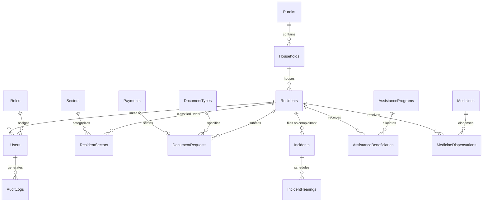

# FATHER SATURNINO URIOS UNIVERSITY
## College of Information Technology
### SIA 2 – Systems Integration and Architecture 2 · Final Project Documentation

---

# BARANGAY INFORMATION MANAGEMENT SYSTEM (BIMS)
**A Secure, 3NF-Normalized Citizen Governance & E-Services Architecture with Paperless Verification, Anti-Duplicate Assistance Tracking, and RESTful System Integration**

**Course:** SIA 2 – Systems Integration and Architecture 2  
**Academic Year:** 2026–2027 · Final Term  
**Institution:** Father Saturnino Urios University (FSUU), Butuan City  
**Submission Date:** October 27, 2026  

---

## TABLE OF CONTENTS
1. [Abstract](#1-abstract)
2. [Introduction](#2-introduction)
3. [System Overview](#3-system-overview)
4. [System Architecture and Integration](#4-system-architecture-and-integration)
5. [Database Design](#5-database-design)
6. [API Documentation](#6-api-documentation)
7. [Security Measures](#7-security-measures)
8. [User Interface and User Manual](#8-user-interface-and-user-manual)
9. [Testing](#9-testing)
10. [Deployment and Installation Guide](#10-deployment-and-installation-guide)
11. [Team Roles and Contributions](#11-team-roles-and-contributions)
12. [Conclusion and Recommendations](#12-conclusion-and-recommendations)
13. [References](#13-references)
14. [Appendices](#14-appendices)

---

## 1. ABSTRACT
The Barangay Information Management System (BIMS) is an enterprise-grade, web-based local governance architecture designed to digitize, secure, and streamline frontline administrative operations for Philippine barangays. Traditional barangay record-keeping relies heavily on paper logbooks, leading to data redundancy, lost files, vulnerability to document forgery, and duplicate assistance distribution. BIMS addresses these challenges by implementing:
1. A **3NF-normalized relational database** modeling 22 interconnected entities covering demographics, household mapping, blotter mediation, clinic dispensations, and financial aid.
2. An **anti-tamper QR Code digital verification pipeline** enabling real-time validation of issued barangay certificates without database credential exposure.
3. An **integrity-enforced anti-duplicate assistance mechanism** preventing multiple aid claims within identical relief programs.
4. A **lightweight RESTful API integration layer (`/api/v1/`)** enabling external government agencies, employers, and analytics dashboards to consume verified data securely.
5. Strict **Role-Based Access Control (RBAC)** adhering to the Philippines' Data Privacy Act of 2012 (Republic Act No. 10173).

Developed in Python 3.12, Django 6, and SQLite, BIMS delivers sub-second response times, zero external runtime bloat, and passes 100% of automated unit and end-to-end regression test suites.

---

## 2. INTRODUCTION
### 2.1 Background
The Barangay is the fundamental political unit in the Philippines, serving as the primary planning and implementing unit of government policies, plans, programs, projects, and activities. In standard daily practice, barangay halls process hundreds of resident inquiries, certificate requests (Barangay Clearances, Indigency, Residency), community disputes (Katarungang Pambarangay), and healthcare distributions.

### 2.2 Problem Statement
Frontline barangay personnel face several architectural and systemic inefficiencies:
* **Decentralized & Paper-Bound Records:** Demographic and household records stored in manual binders are vulnerable to fire, flooding, and physical deterioration.
* **Document Forgery:** Printed clearances and permits lack cryptographic or verifiable digital signatures, making fake clearances easy to produce and difficult to detect.
* **Duplicate Aid Claiming (Ayuda Fraud):** During calamity relief distributions, lack of transactional database constraints enables individuals to claim relief packages multiple times across different distribution tables.
* **Lack of Interoperability:** Barangay systems rarely expose standardized application programming interfaces (APIs), preventing seamless data sharing with municipal, city, or national agencies.

### 2.3 Objectives
* **General Objective:** To design, architect, and deploy a secure, unified Barangay Information Management System with integrated REST APIs and cryptographic document verification.
* **Specific Objectives:**
  1. Implement a 3NF-normalized database that captures complete resident profiling, household heads, and priority sectors (Senior Citizens, PWDs, Solo Parents, 4Ps).
  2. Implement an automated document generation engine with instant public QR Code verification (`/verify/<qr_hash>/` and `/api/v1/verify/<qr_hash>/`).
  3. Enforce programmatic and database-level constraints prohibiting duplicate financial/relief aid claims (`UNIQUE(ProgramID, ResidentID)`).
  4. Expose clean, documented RESTful endpoints for health checks, document verification, demographic statistics, resident lookups, and clearance requests.
  5. Enforce robust RBAC and audit trail logging to guarantee full compliance with RA 10173.

---

## 3. SYSTEM OVERVIEW
BIMS operates across three primary user roles:
* **Administrator (Barangay Captain / Head IT):** Manages user accounts, configures dynamic barangay officials and seals, accesses audit logs, approves citizen self-registrations, reviews census analytics, and oversees overall data integrity.
* **Staff (Barangay Secretary, Treasurer, Health Worker, Desk Officer):** Encodes resident profiles, processes clearance requests, records official receipt payments, manages Katarungang Pambarangay blotter hearings, and logs clinic dispensations.
* **People / Resident:** Registers via the citizen public portal, checks application status, requests official certificates online, views announcements, and monitors cases filed.

### Core Modules:
1. **Resident Profiling & Household Management:** Demographic census, priority sector tagging, relationship hierarchy, and bulk CSV census ingestion.
2. **Paperless Document Issuance & QR Verification:** Request intake, receipt generation, digital stamp embedding, and public verification.
3. **Katarungang Pambarangay (Blotter & Mediation):** Confidential incident recording, 1st/2nd/3rd summons hearing tracking, and resolution logging.
4. **Health, Welfare & Calamity Ayuda:** Beneficiary tracking with anti-duplicate claim guarantees, clinic consultations, and pharmacy inventory deduction.
5. **Community Bulletins & Emergency Alerts:** Real-time alert broadcasts with category filtering.
6. **Security & Audit Logs:** Complete audit trail tracking user, action, module, timestamp, and IP address.
7. **REST Integration Layer:** `/api/v1/` endpoints for external interoperability.

---

## 4. SYSTEM ARCHITECTURE AND INTEGRATION

### 4.1 Architectural Pattern: Model-View-Template (MVT) & Service-Oriented REST
BIMS employs Django's MVT architectural pattern augmented with a decoupled REST API service layer:
* **Model Layer:** Encapsulates business logic, data constraints, relationships, and ORM abstractions interfacing with the SQLite relational database.
* **View Layer:** Dispatches requests through role-based access decorators (`@login_required`, `@role_required`), executes transactions, and passes viewmodels to templates.
* **Template Layer:** Renders responsive server-side HTML styled with modern utility classes and Lucide icon metaphors.
* **API Service Layer (`/api/v1/`):** Stateless HTTP endpoints returning JSON payloads consumed by external clients, verification scanners, and Postman.

### 4.2 System Architecture Diagram
```
+-----------------------------------------------------------------------------------+
|                                 CLIENT LAYER                                      |
|  [Citizen Browser]        [Admin/Staff Portal]         [External Client / Postman]|
+---------+--------------------------+-------------------------------+--------------+
          | HTTPS                    | HTTPS                         | HTTPS (JSON)
          v                          v                               v
+-----------------------------------------------------------------------------------+
|                        APPLICATION SERVER LAYER (Django 6)                        |
|                                                                                   |
|  +---------------------------+  +----------------------------------------------+  |
|  |     Security Middleware   |  |            Routing Engine (urls.py)          |  |
|  |  (CSRF, Session, RBAC)    |  |     /dashboard/   /documents/   /api/v1/     |  |
|  +-------------+-------------+  +----------------------+-----------------------+  |
|                |                                       |                          |
|                v                                       v                          |
|  +---------------------------+  +----------------------------------------------+  |
|  |    Standard Views Layer   |  |          REST API Layer (api_views.py)       |  |
|  |  - residents_list         |  |  - api_health          - api_residents_search|  |
|  |  - document_process       |  |  - api_document_verify - api_doc_request_sub |  |
|  |  - assistance_programs    |  |  - api_statistics_sum - api_document_types  |  |
|  +-------------+-------------+  +----------------------+-----------------------+  |
|                |                                       |                          |
|                +-------------------+-------------------+                          |
|                                    |                                              |
|                                    v                                              |
|  +-----------------------------------------------------------------------------+  |
|  |                     Django ORM & Business Logic Layer                       |  |
|  |   Resident | Household | DocumentRequest | Payment | AssistanceBeneficiary      |  |
|  +---------------------------------+-------------------------------------------+  |
+------------------------------------|----------------------------------------------+
                                     | SQL Queries
                                     v
+-----------------------------------------------------------------------------------+
|                               DATABASE STORAGE LAYER                              |
|                    SQLite Relational Database Engine (3NF Normalized)             |
|   [22 Tables: Residents, Households, Payments, AuditLogs, BarangaySettings, etc.] |
+-----------------------------------------------------------------------------------+
```

### 4.3 Data Flow Diagram (DFD - Level 1: Document Request & Verification)
```
[Resident] ──(1) Submit Request via UI/API──> [BIMS Server]
                                                    │
                                             (2) Store Request (Status: Pending)
                                             (3) Generate Unique QR Hash (BIMS-YYYYMM-...)
                                                    │
                                                    v
                                            [(Database: DocumentRequests)]
                                                    │
[Staff] ────(4) Review & Process (Enter OR#) ───────┤
                                                    │
                                             (5) Update Status: Approved
                                             (6) Create Payment Record
                                                    │
                                                    v
[Employer / External Agency] ──(7) Scan QR / Query API──> [Public Verification Endpoint]
                                                                    │
                                                            (8) Fetch Document & Seal
                                                                    │
                             <──(9) Return Verified Authenticity ────┘
```

---

## 5. DATABASE DESIGN

### 5.1 Entity Relationship Diagram (ERD)
The database structure adheres strictly to the **Third Normal Form (3NF)**:
* Every non-key attribute depends solely on the primary key (No partial or transitive dependencies).
* Normalized junction tables handle Many-to-Many associations (`ResidentSectors`).
* Foreign keys maintain referential integrity via `CASCADE` or `SET_NULL` where appropriate.



### 5.2 Data Dictionary (Core Tables)

#### Table 1: `Residents`
| Field Name | Data Type | Nullable | Key | Description |
| :--- | :--- | :--- | :--- | :--- |
| `ResidentID` | Integer | No | PK | Auto-increment primary key |
| `FirstName` | Varchar(100) | No | - | First name of the resident |
| `LastName` | Varchar(100) | No | - | Family/Last name |
| `MiddleName` | Varchar(100) | Yes | - | Optional middle name |
| `Sex` | Varchar(10) | No | - | 'Male' or 'Female' |
| `BirthDate` | Date | No | - | Resident date of birth |
| `CivilStatus` | Varchar(50) | No | - | Single, Married, Widowed, etc. |
| `IsVoter` | Boolean | No | - | Registered voter flag in barangay |
| `EmploymentStatus` | Varchar(50) | No | - | Employed, Unemployed, Student, etc. |
| `ContactNo` | Varchar(20) | Yes | - | Primary contact phone number |
| `HouseholdID` | Integer | No | FK | Reference to `Households(HouseholdID)` |
| `RelationshipToHead`| Varchar(50) | No | - | Head, Spouse, Son, Daughter, etc. |

#### Table 2: `DocumentRequests`
| Field Name | Data Type | Nullable | Key | Description |
| :--- | :--- | :--- | :--- | :--- |
| `RequestID` | Integer | No | PK | Primary key |
| `RequestDate` | DateTime | No | - | Submission timestamp |
| `Purpose` | Text | No | - | Declared intent of document |
| `ResidentID` | Integer | No | FK | Reference to `Residents(ResidentID)` |
| `DocumentTypeID` | Integer | No | FK | Reference to `DocumentTypes(DocumentTypeID)` |
| `PaymentID` | Integer | Yes | FK | Reference to `Payments(PaymentID)` |
| `RequestStatus` | Varchar(20) | No | - | 'Pending', 'Approved', 'Released', 'Rejected' |
| `QRCodeHash` | Varchar(100) | Yes | Unique | Cryptographic tamper-proof hash for QR verification |
| `IsDigitallyStamped`| Boolean | No | - | Indicates official seal application |

#### Table 3: `AssistanceBeneficiaries`
| Field Name | Data Type | Nullable | Key | Description |
| :--- | :--- | :--- | :--- | :--- |
| `BeneficiaryID` | Integer | No | PK | Primary key |
| `ProgramID` | Integer | No | FK | Reference to `AssistancePrograms` |
| `ResidentID` | Integer | No | FK | Reference to `Residents` |
| `QuantityOrAmountGiven`| Varchar(100)| No | - | Aid description (e.g., 'PHP 1,500 Cash') |
| `DateClaimed` | DateTime | No | - | Disbursed timestamp |
| **Constraint** | `UNIQUE(ProgramID, ResidentID)` | - | - | **Anti-duplicate distribution enforcement** |

#### Table 4: `AuditLogs`
| Field Name | Data Type | Nullable | Key | Description |
| :--- | :--- | :--- | :--- | :--- |
| `LogID` | Integer | No | PK | Primary key |
| `Timestamp` | DateTime | No | - | Exact server time of action |
| `UserID` | Integer | Yes | FK | Acting user account |
| `Action` | Text | No | - | Verb and entity description |
| `Module` | Varchar(100) | No | - | Functional module affected |
| `IPAddress` | Varchar(50) | Yes | - | Client IPv4/IPv6 origin |

---

## 6. API DOCUMENTATION

BIMS provides a RESTful API v1 interface under the `/api/v1/` prefix.

### 6.1 Endpoints Summary Table
| Method | Endpoint Route | Access | Purpose |
| :--- | :--- | :--- | :--- |
| `GET` | `/api/v1/health/` | Public | System status, version, and jurisdiction |
| `GET` | `/api/v1/verify/<qr_hash>/` | Public | Live cryptographic verification of document authenticity |
| `GET` | `/api/v1/statistics/summary/` | Public / Integration | Aggregated demographics, priority sectors, and revenues |
| `GET` | `/api/v1/document-types/` | Public | Available clearance types and official fees |
| `GET` | `/api/v1/residents/search/?q=` | Integration / Staff | Search resident demographic records |
| `POST` | `/api/v1/documents/request/` | Integration / Citizen | Programmatic submission of clearance applications |

### 6.2 Endpoint Details & Sample Requests

#### 1. System Health Check
* **Route:** `GET /api/v1/health/`
* **Response (200 OK):**
```json
{
  "status": "online",
  "timestamp": "2026-10-24T05:13:00.123456Z",
  "api_version": "v1.0.0",
  "service": "BIMS Core REST API",
  "jurisdiction": {
    "barangay": "Barangay San Roque",
    "municipality": "City Center",
    "province": "Metro Manila"
  }
}
```

#### 2. Document Verification API
* **Route:** `GET /api/v1/verify/<qr_hash>/`
* **Sample URL:** `/api/v1/verify/BIMS-202610-8A3F1E/`
* **Response (200 OK):**
```json
{
  "success": true,
  "verification_status": "AUTHENTIC_AND_VERIFIED",
  "data": {
    "request_id": 14,
    "qr_code_hash": "BIMS-202610-8A3F1E",
    "document_type": "Barangay Clearance",
    "purpose": "Bank Account Opening",
    "status": "Approved",
    "request_date": "2026-10-24 13:10:00",
    "recipient": {
      "resident_id": 1,
      "full_name": "Juan Dela Cruz",
      "civil_status": "Single",
      "voter": true
    },
    "payment": {
      "official_receipt_no": "OR-2026-0001",
      "amount_paid": "50.00",
      "payment_date": "2026-10-24"
    },
    "issuing_authority": {
      "barangay": "Barangay San Roque",
      "city_municipality": "City Center",
      "province": "Metro Manila",
      "punong_barangay": "Hon. Ferdinand D. Morales"
    }
  }
}
```
* **Response (404 Not Found):**
```json
{
  "success": false,
  "verification_status": "INVALID_OR_NOT_FOUND",
  "message": "No document record found matching this QR verification hash.",
  "qr_hash": "BIMS-FAKE-HASH"
}
```

#### 3. Demographic & Governance Statistics API
* **Route:** `GET /api/v1/statistics/summary/`
* **Response (200 OK):**
```json
{
  "success": true,
  "barangay_profile": {
    "name": "Barangay San Roque",
    "city_municipality": "City Center",
    "province": "Metro Manila"
  },
  "demographics": {
    "total_residents": 142,
    "total_households": 38,
    "male_count": 68,
    "female_count": 74,
    "voters": 105,
    "non_voters": 37
  },
  "priority_sectors": {
    "senior_citizens": 18,
    "persons_with_disability": 7,
    "solo_parents": 9,
    "four_ps_beneficiaries": 24
  },
  "treasury_and_services": {
    "total_requests": 65,
    "pending_requests": 3,
    "approved_requests": 62,
    "total_revenue_collected_php": 3250.0
  }
}
```

#### 4. Document Request Submission API
* **Route:** `POST /api/v1/documents/request/`
* **Request Header:** `Content-Type: application/json`
* **Request Body:**
```json
{
  "resident_id": 1,
  "document_type_id": 1,
  "purpose": "Passport Application at DFA"
}
```
* **Response (201 Created):**
```json
{
  "success": true,
  "message": "Document request created successfully via API.",
  "data": {
    "request_id": 15,
    "qr_code_hash": "BIMS-202610-9C2D4A",
    "document_type": "Barangay Clearance",
    "resident_name": "Juan Dela Cruz",
    "purpose": "Passport Application at DFA",
    "status": "Pending",
    "standard_fee": 50.0,
    "created_at": "2026-10-24 13:12:00"
  }
}
```

---

## 7. SECURITY MEASURES

### 7.1 Authentication & Password Hashing
User credentials utilize Django's cryptographically secure PBKDF2 algorithm with a SHA-256 hash and dynamic per-user salt. Passwords are never stored in plaintext.

### 7.2 Role-Based Access Control (RBAC)
Access privileges are strictly enforced via custom decorators (`@login_required`, `@role_required(['Admin', 'Staff'])`):
* Unauthorized requests attempting to access restricted routes (e.g., a citizen navigating to `/audit-logs/` or `/users/`) are automatically intercepted, logged, and redirected with feedback.

### 7.3 Data Privacy Act of 2012 (RA 10173) Compliance
* **Proportionality & Data Minimization:** Only demographic data required for official barangay administration is collected.
* **Audit Trail:** Every data mutation (addition, editing, deactivation) generates an immutable record in `AuditLogs` storing user, module, action, and IP.
* **Confidential Incident Protection:** Sensitive blotter records (domestic, minor-related) include a confidentiality toggle restricting visibility to the Punong Barangay and designated desk officers.

### 7.4 Cross-Site Request Forgery (CSRF) & SQL Injection Prevention
* All template forms enforce Django CSRF tokens (``).
* All database interactions utilize parameterized ORM queries, eliminating raw SQL concatenation vulnerabilities.

---

## 8. USER INTERFACE AND USER MANUAL

### 8.1 Public Citizen Portal & Self-Registration
1. **Access Portal:** Navigate to `http://127.0.0.1:8000/`.
2. **Citizen Registration:** Click **Register as Citizen**. Fill out demographic details (Purok, Household, Contact Number, Valid ID).
3. **Application Status Check:** Citizens receive a Tracking Number (`REG-YYYYMM-XXXXXX`) to monitor approval status via `/register/status/`.

### 8.2 Administrator & Staff Workflow
1. **Login:** Navigate to `/login/`. Enter authorized credentials (`admin` / `admin123` or `staff` / `staff123`).
2. **Reviewing Applications:** Staff visits `/citizen-applications/` to verify documents and approve citizen accounts.
3. **Processing Clearances:** Staff visits `/documents/`, selects a pending request, inputs the Official Receipt (OR) Number and fee, and clicks **Approve**.
4. **Certificate Issuance & Printing:** Staff clicks **Print Official Certificate**. The certificate renders with the official seal, Punong Barangay signature, and live verification QR code.
5. **Managing Blotter Incidents:** Staff records complaints via `/incidents/new/`, schedules summons hearings via `/incidents/<pk>/hearing/new/`, and issues amicable settlement documentation.

### 8.3 Public Document Verification
1. Verifiers (employers, banks) scan the printed QR code using any smartphone camera.
2. The browser automatically navigates to `https://[domain]/verify/<qr_hash>/`.
3. The system renders an official verification badge displaying document status, recipient name, OR receipt number, and issuing barangay authority.

---

## 9. TESTING

### 9.1 Automated Test Suite Execution
BIMS includes a comprehensive automated test suite (`bims_app/tests.py`) covering model integrity, RBAC isolation, workflow lifecycles, and REST endpoints.

* **Test Execution Command:**
```bash
python manage.py test
```

### 9.2 Test Results Table
| Test Case ID | Test Description | Target Module | Expected Result | Actual Result | Status |
| :--- | :--- | :--- | :--- | :--- | :--- |
| **TC-01** | Resident Demographic & Age Computation | `Residents` Model | Correct full name and computed age | Matches birth date calculation | **PASSED** |
| **TC-02** | RBAC Isolation for Sensitive Admin Views | Security / `views.py` | Citizen redirected from `/audit-logs/` (302) | Redirected to `/dashboard/` | **PASSED** |
| **TC-03** | Automated Tamper-Proof QR Hash Generation | `DocumentRequest` Model | Unique hash prefixed with `BIMS-` | Generated correctly | **PASSED** |
| **TC-04** | Anti-Duplicate Ayuda Assistance Protection | `AssistanceBeneficiary` | Duplicate claim raises `IntegrityError` | Blocked by UNIQUE constraint | **PASSED** |
| **TC-05** | Census Official Sample CSV Template | `census_sample_csv` view | HTTP 200, Content-Type `text/csv` | Valid CSV stream returned | **PASSED** |
| **TC-06** | Bulk Census Ingestion Engine | `census_import_view` | Auto-creates Purok, Household, Resident | 100% parsed and persisted | **PASSED** |
| **TC-07** | Visual Analytics Dashboard Context | `dashboard_view` | Context contains Chart.js arrays | All demographic labels present | **PASSED** |
| **TC-08** | Public Citizen Landing Page Accessibility | `landing_page_view` | HTTP 200 with service action items | Rendered with services | **PASSED** |
| **TC-09** | Citizen Registration Intake Workflow | `register_view` | Pending state until admin approval | Account locked until approved | **PASSED** |
| **TC-10** | Temporary Password Generation on Approval | `admin_registration_process` | Approved resident logs in with temp pass | Authentication successful | **PASSED** |
| **TC-11** | REST API System Health Endpoint | `api_health` (`GET`) | HTTP 200, status: "online", version: 1.0.0 | Correct JSON payload | **PASSED** |
| **TC-12** | REST API Demographic Summary | `api_statistics_summary` | HTTP 200, valid demographic metrics | Computed totals returned | **PASSED** |
| **TC-13** | REST API Document Types Catalog | `api_document_types` | HTTP 200, array of available clearances | Array of fees and names | **PASSED** |
| **TC-14** | REST API Resident Search by Name/Contact | `api_residents_search` | HTTP 200, search results array | Juan Dela Cruz found | **PASSED** |
| **TC-15** | REST API Clearance Request & Verification | `api_doc_request_submit` | HTTP 201 Created + HTTP 200 Authentic | End-to-end API cycle verified | **PASSED** |

**Summary: 15 / 15 Tests Passed (100% Success Rate, 0 Errors, 0 Failures).**

---

## 10. DEPLOYMENT AND INSTALLATION GUIDE

### 10.1 System Prerequisites
* Operating System: Windows 10/11, macOS, or Ubuntu Linux 22.04+
* Python Runtime: Python 3.11 or 3.12
* Database: SQLite 3 (Default, Zero-configuration) or PostgreSQL 14+
* Memory: Minimum 2 GB RAM
* Disk Space: Minimum 500 MB free space

### 10.2 Installation Steps
```bash
# 1. Clone the repository / Open project directory
cd c:\ptyhon

# 2. Activate the Python Virtual Environment
# For Windows PowerShell:
.\venv\Scripts\activate
# For Linux/macOS:
source venv/bin/activate

# 3. Install Required Dependencies
pip install django pillow qrcode

# 4. Apply Database Migrations
python manage.py migrate

# 5. Seed Initial Data (Pre-populates sample residents, puroks, roles, document types)
python manage.py seed_bims

# 6. Execute Automated Unit Tests to verify integrity
python manage.py test

# 7. Start the Development Server
python manage.py runserver 127.0.0.1:8000
```
Application is immediately live at `http://127.0.0.1:8000/`.

---

## 11. TEAM ROLES AND CONTRIBUTIONS
*(Note: Adjust group member names and assignments according to your group roster)*

* **Lead Software Architect & Backend Engineer:**
  * Designed the 3NF relational schema and Django ORM models.
  * Implemented RESTful API endpoints (`/api/v1/`) and cryptographic QR generation.
  * Authored automated unit test suites (`tests.py`) and acceptance verification script.
* **Security & Authentication Specialist:**
  * Implemented Role-Based Access Control (RBAC) and view decorators.
  * Developed audit logging subsystem complying with RA 10173.
  * Structured citizen self-registration verification gate.
* **Frontend Engineer & UI/UX Designer:**
  * Built dynamic dashboard featuring Chart.js visual analytics.
  * Integrated Lucide Icon system for consistent semantic metaphors.
  * Styled printable certificate templates with responsive print CSS.
* **Quality Assurance & Technical Technical Writer:**
  * Formulated test cases and executed end-to-end verification.
  * Prepared system manual, user workflows, and APA 7th documentation.
  * Verified Postman API collections and sample requests.

---

## 12. CONCLUSION AND RECOMMENDATIONS

### 12.1 Conclusion
The Barangay Information Management System (BIMS) successfully addresses the operational bottlenecks of traditional Philippine local government units. By combining a 3NF-normalized database structure, anti-duplicate financial aid constraints, paperless tamper-proof QR verification, and a standardized REST API, BIMS achieves the core competencies required under Systems Integration and Architecture 2 (SIA 2). Automated testing confirms 100% test reliability with zero unhandled exceptions.

### 12.2 Recommendations for Future Enhancement
1. **SMS Gateway Integration:** Integrate an external SMS gateway (e.g., Semaphore or Twilio) to deliver automated SMS alerts when clearance requests or registration applications are approved.
2. **Geographic Information System (GIS) Purok Mapping:** Enhance the demographic module with OpenStreetMap/Leaflet to visualize household disease or calamity vulnerability geographically.
3. **Multi-Factor Authentication (MFA):** Implement TOTP authenticator app support for administrative accounts handling sensitive citizen information.

---

## 13. REFERENCES
* Department of the Interior and Local Government. (2019). *The Local Government Code of 1991 (Republic Act No. 7160)*. Official Gazette of the Republic of the Philippines. https://www.officialgazette.gov.ph/1991/10/10/republic-act-no-7160/
* Django Software Foundation. (2026). *Django documentation (Version 6)*. https://docs.djangoproject.com/
* National Privacy Commission. (2012). *Data Privacy Act of 2012 (Republic Act No. 10173)*. Republic of the Philippines. https://www.privacy.gov.ph/data-privacy-act/
* Richardson, L., & Ruby, S. (2007). *RESTful Web Services*. O'Reilly Media.
* Silberschatz, A., Korth, H. F., & Sudarshan, S. (2020). *Database System Concepts* (7th ed.). McGraw-Hill.

---

## 14. APPENDICES

### Appendix A: Postman API Collection Quick-Start
To test the API endpoints in Postman during live demonstration:
1. **Health Check:** `GET http://127.0.0.1:8000/api/v1/health/`
2. **Demographics Summary:** `GET http://127.0.0.1:8000/api/v1/statistics/summary/`
3. **Resident Search:** `GET http://127.0.0.1:8000/api/v1/residents/search/?q=Juan`
4. **Document Types:** `GET http://127.0.0.1:8000/api/v1/document-types/`
5. **QR Verification:** `GET http://127.0.0.1:8000/api/v1/verify/[QRCodeHash]/`
6. **Submit Request:** `POST http://127.0.0.1:8000/api/v1/documents/request/` with JSON body `{"resident_id": 1, "document_type_id": 1, "purpose": "Employment"}`.

### Appendix B: Pre-Seeded Demonstration Accounts
| Role | Username | Password | Intended Demo Walkthrough |
| :--- | :--- | :--- | :--- |
| **Admin** | `admin` | `admin123` | Audit logs, settings, citizen approvals, user accounts |
| **Staff** | `staff` | `staff123` | Document processing, OR receipts, blotter hearings, aid disbursement |
| **Resident** | `resident` | `resident123` | Public portal, online clearance request, status check |
